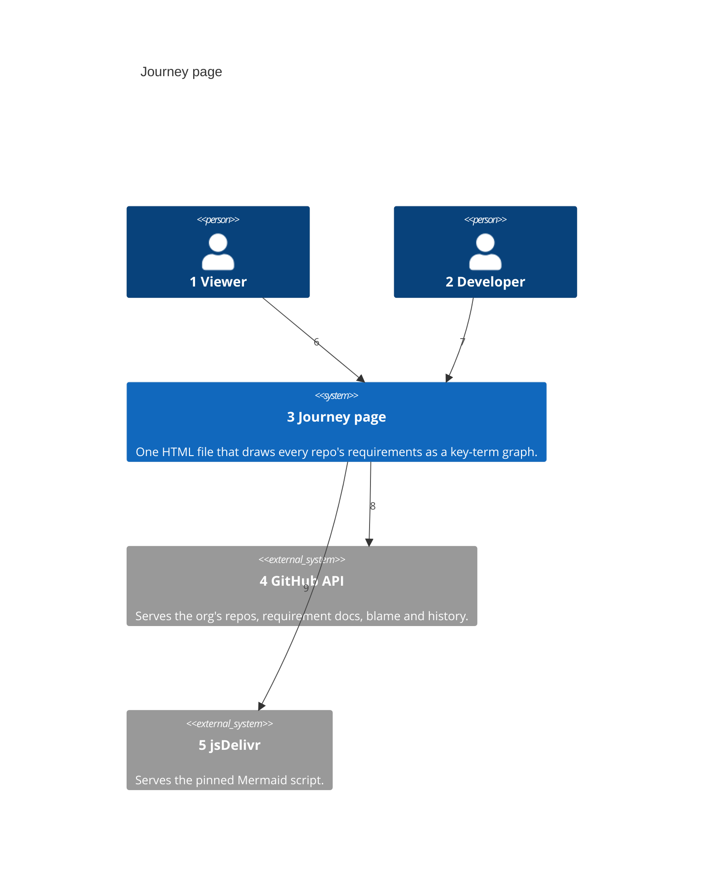
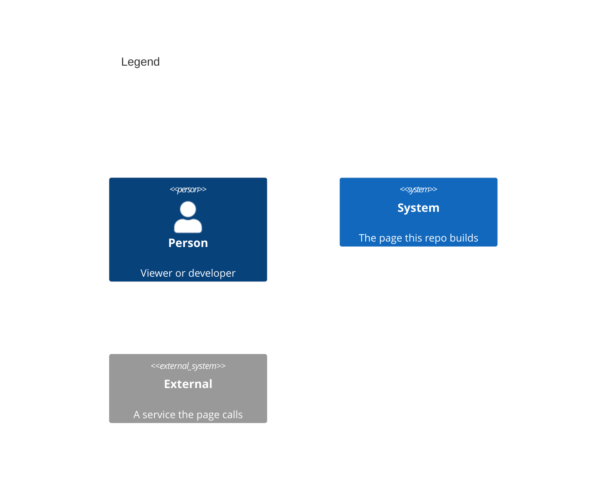

# System Context

| #   | Description                                         | Why                                                 |
| --- | --------------------------------------------------- | --------------------------------------------------- |
| 1   | Someone who opens the page with their own token.    | The page exists to show them the journey.           |
| 2   | Someone who builds the page and runs its tests.     | Every page comes from their build.                  |
| 3   | The built page and the core code inlined into it.   | The boundary the other views break down.            |
| 4   | The API the page reads with the viewer's token.     | Requirements live in each repo, not in this one.    |
| 5   | The CDN that serves Mermaid at a pinned version.    | Mermaid draws the graph; the script is checked.     |
| 6   | The viewer pastes a token and reads the graph.      | The main way in.                                    |
| 7   | The developer runs the build.                       | One command writes the one-file page.               |
| 8   | The page fetches docs, blame and history.           | Nothing is stored but the token.                    |
| 9   | The page loads Mermaid with an integrity hash.      | A changed script never runs with the token in reach. |
