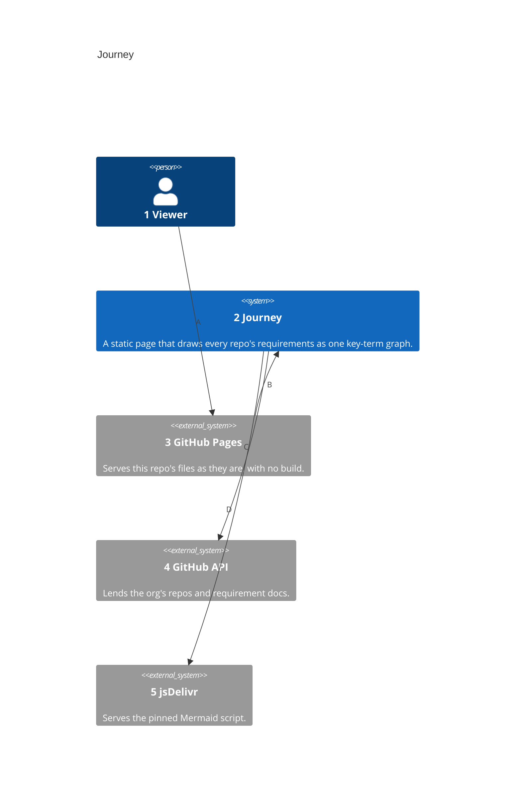
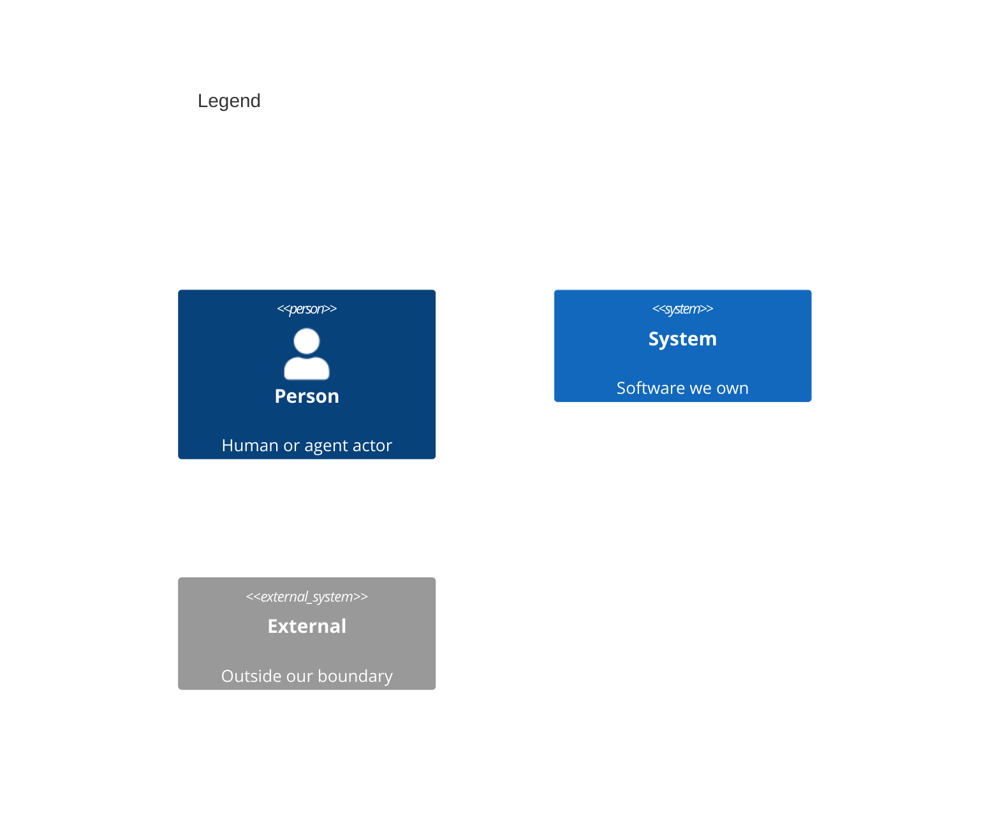

# System Context

Numbers on nodes and arrows match the callout table.

| #   | Description                                      | Why                                                |
| --- | ------------------------------------------------ | -------------------------------------------------- |
| 1   | Someone who opens the page with their own token. | Requirements name this actor in a Given.           |
| 2   | The page and its two scripts.                    | The boundary the other views break down.           |
| 3   | GitHub Pages, which serves the files unchanged.  | Nothing is built, scheduled or stored there.       |
| 4   | The API the page reads with the viewer's token.  | Requirements live in each repo, not in this one.   |
| 5   | The CDN that serves Mermaid at a pinned version. | Mermaid draws the graph.                           |
| A   | The viewer opens the public page.                | The only way in.                                   |
| B   | Pages serves the HTML and its scripts.           | Private requirements are never published.          |
| C   | The page fetches every repo's requirement docs.  | Only the token is stored, in the viewer's browser. |
| D   | The page loads Mermaid with an integrity hash.   | A changed script never runs with the token.        |
