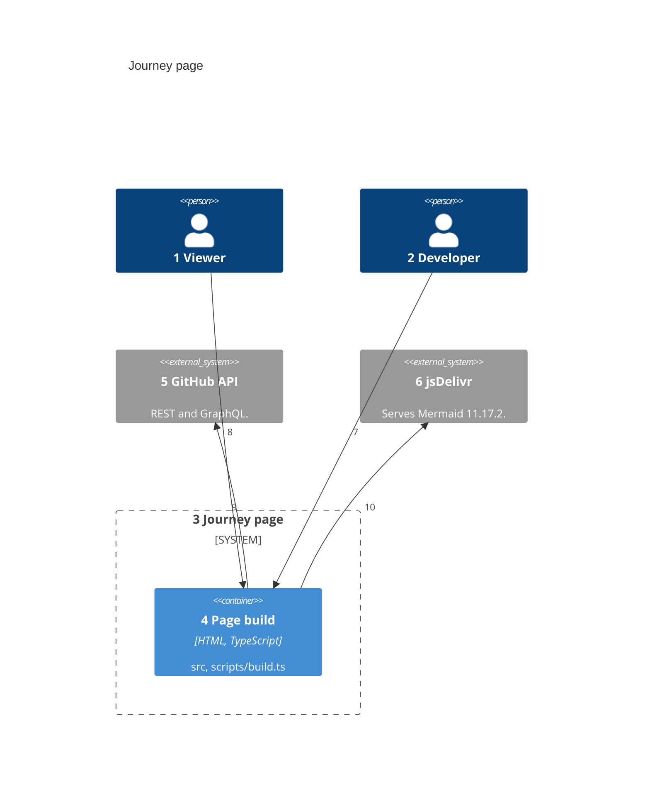
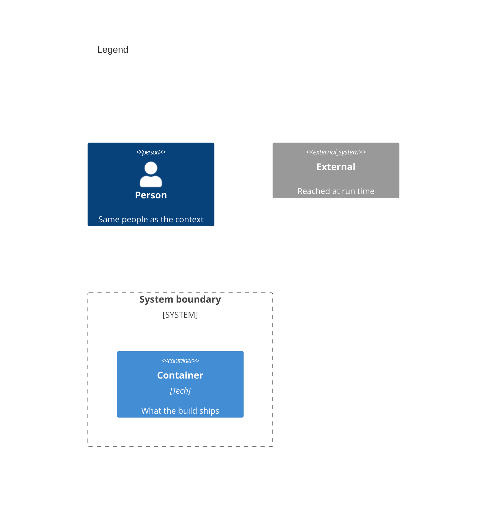

# Containers

| #   | Description                                                | Why                                                  |
| --- | ---------------------------------------------------------- | ---------------------------------------------------- |
| 1   | Same viewer as the system context.                         | Opens the built page.                                |
| 2   | Same developer as the system context.                      | Builds the page and runs its tests.                  |
| 3   | The page's boundary.                                       | Everything inside it ships from this repo.           |
| 4   | The one-file page `make build` writes from `src`.          | It runs in the viewer's browser, with no server.     |
| 5   | Same API as the system context.                            | The page reads it with the viewer's token.           |
| 6   | Same CDN as the system context.                            | The page checks the script's integrity hash.         |
| 7   | The developer runs `make build`.                           | The build writes `dist/index.html`.                  |
| 8   | The viewer opens the page and pastes a token.              | The token stays in that browser's local storage.     |
| 9   | The page fetches repos, docs, blame and history.           | Everything else is built in memory on each load.     |
| 10  | The page loads Mermaid to draw the graph.                  | Mermaid is the only script from outside the repo.    |
