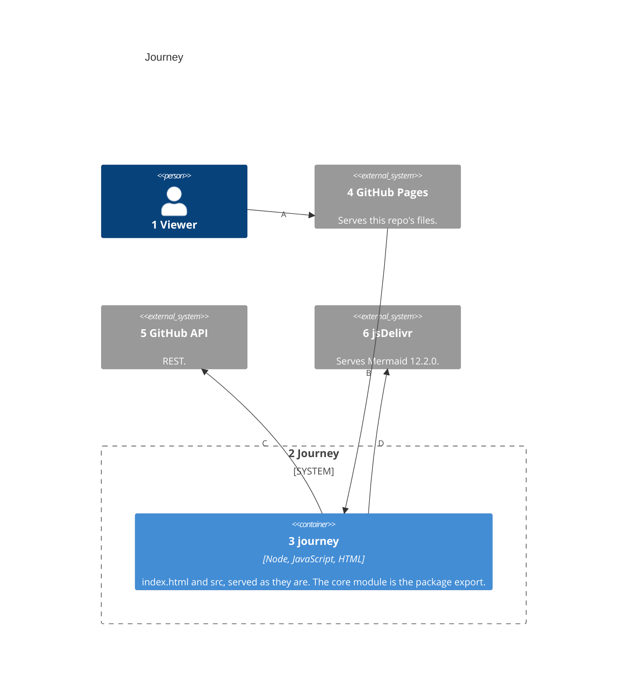
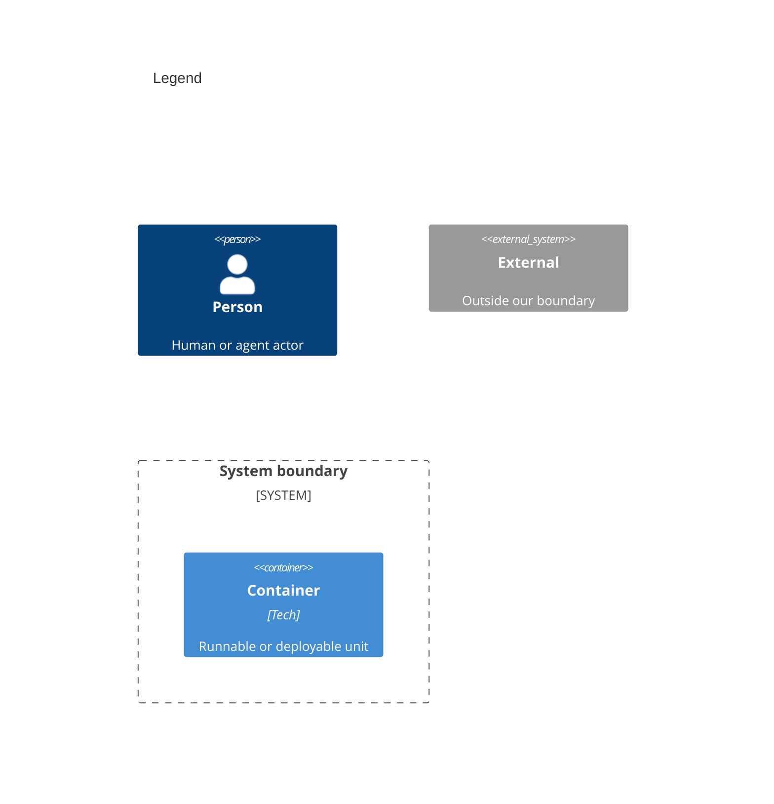

# Containers

Numbers on nodes and arrows match the callout table.

| #   | Description                                       | Why                                               |
| --- | ------------------------------------------------- | ------------------------------------------------- |
| 1   | Same viewer as the system context.                | Every visit starts with this actor.               |
| 2   | Journey's boundary.                               | Everything inside it ships from this repo.        |
| 3   | The `journey` package: `index.html` and `src`.    | It runs in the viewer's browser, with no server.  |
| 4   | Same GitHub Pages as the system context.          | It serves the main branch's files unchanged.      |
| 5   | Same API as the system context.                   | The page reads it with the viewer's token.        |
| 6   | Same CDN as the system context.                   | The page checks the script's integrity hash.      |
| A   | The viewer opens the page.                        | The public way in.                                |
| B   | Pages hands the browser the HTML and its scripts. | No build step stands between a commit and Pages.  |
| C   | The page lists repos and reads each one's docs.   | Everything else is built in memory on each load.  |
| D   | The page loads Mermaid to draw the graph.         | Mermaid is the only script from outside the repo. |
