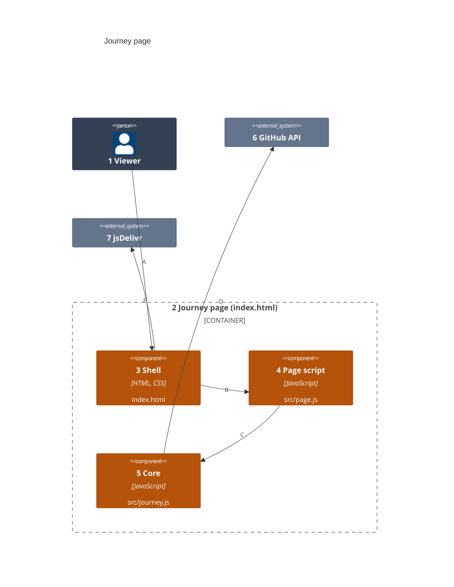
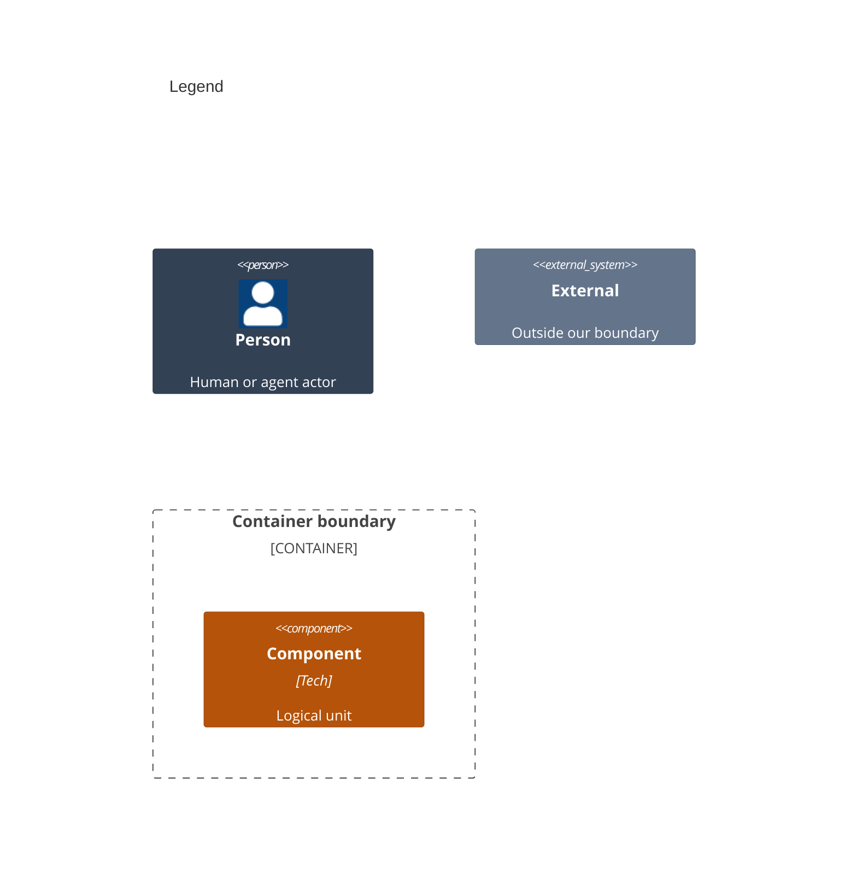

# Components

Numbers on nodes and letters on arrows match the callout table.

| #   | Description                                            | Why                                                |
| --- | ------------------------------------------------------ | -------------------------------------------------- |
| 1   | Same viewer as the containers view.                    | Uses only the shell.                               |
| 2   | The page container.                                    | Its components split its sources.                  |
| 3   | The layout, styles and the two script tags.            | Light and dark styles live here.                   |
| 4   | The token screen, sliders, graph drawing and details.  | It takes its window, fetch and Mermaid as inputs.  |
| 5   | Parsing, key terms, the graph, Mermaid text and fetch. | It touches no DOM, so tests call it directly.      |
| 6   | Same API as the containers view.                       | Only the core calls it.                            |
| 7   | Same CDN as the containers view.                       | Only the shell loads from it.                      |
| A   | The viewer pastes a token, moves sliders, taps terms.  | The main way in.                                   |
| B   | The shell's module script starts the page script.      | It passes the browser's own fetch and Mermaid.     |
| C   | The page script calls the core to load and draw.       | The page script holds no parsing or fetch logic.   |
| D   | The core lists repos and reads their docs.             | Bad tokens and rate limits stop it with a message. |
| E   | The shell loads Mermaid before the page script runs.   | Deferred scripts run in document order.            |
