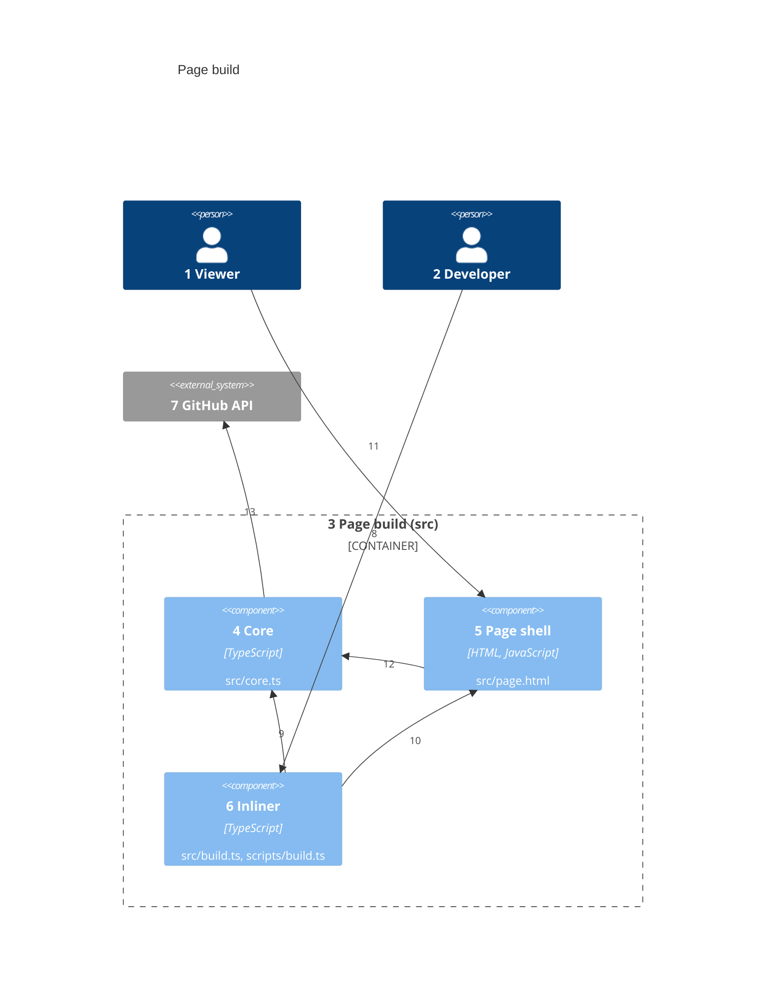
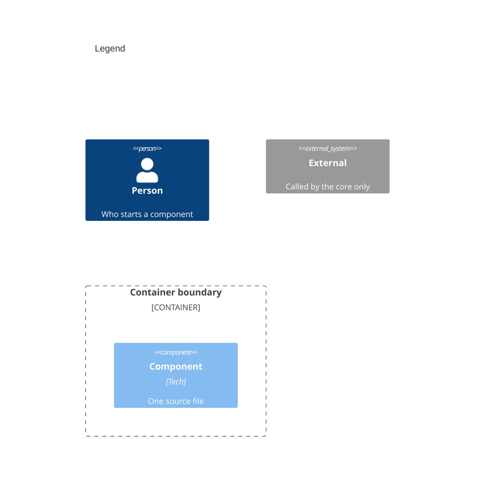

# Components

| #   | Description                                                                  | Why                                                  |
| --- | ---------------------------------------------------------------------------- | ---------------------------------------------------- |
| 1   | Same viewer as the containers view.                                          | Uses only the page shell.                            |
| 2   | Same developer as the containers view.                                       | Runs only the build.                                 |
| 3   | The page build container, from `src`.                                            | Its components split its sources.                    |
| 4   | [`src/core.ts`](../../src/core.ts) parses docs, builds the graph and fetches. | Tests run it in node with replayed GitHub answers.   |
| 5   | [`src/page.html`](../../src/page.html) holds the layout and the page script. | It draws, lists acceptances and keeps the token.     |
| 6   | [`src/build.ts`](../../src/build.ts) puts the core into the shell.            | The built page is one file.                          |
| 7   | Same API as the containers view.                                             | Only the core calls it.                              |
| 8   | `make build` calls the inliner through `scripts/build.ts`.                   | The output folder is its only argument.              |
| 9   | The build reads the core.                                                    | The page ships the same code the tests ran.          |
| 10  | The build writes the core into the shell's script block.                    | No local script is loaded at run time.               |
| 11  | The viewer pastes a token, moves the sliders and taps terms.                 | The main way in.                                     |
| 12  | The shell calls the core to load, reduce and draw.                           | The shell holds no parsing or fetch logic.           |
| 13  | The core lists repos, reads docs, blame and history.                         | Bad tokens and rate limits stop it with a message.   |
