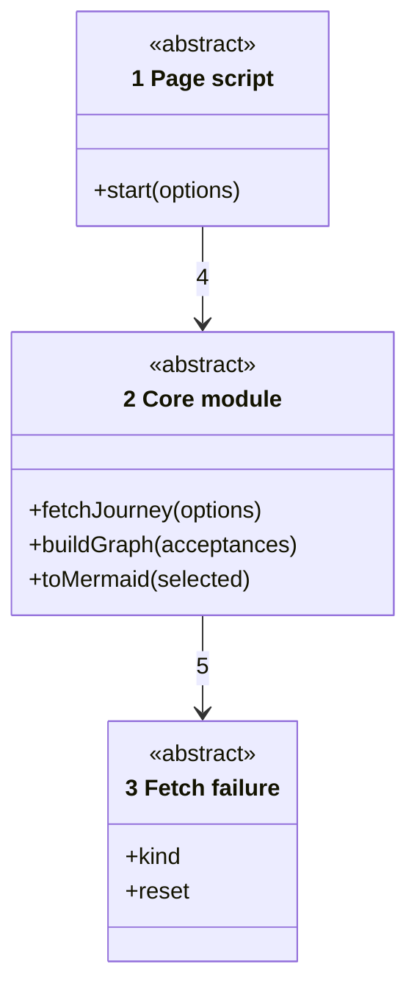
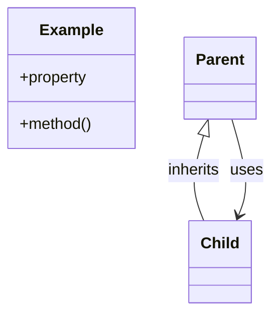

# Code

Numbers on classes and relationships match the callout table.

| #   | Description                                                    | Why                                                  |
| --- | -------------------------------------------------------------- | ---------------------------------------------------- |
| 1   | The page script, which starts the screens in a window.         | Tests start it in jsdom the same way.                |
| 2   | The core module: fetch, key terms, graph and Mermaid text.     | Fitness reads no JavaScript, so these stay abstract. |
| 3   | A failed GitHub answer: a bad token, a rate limit or HTTP.     | The page words each kind its own way.                |
| 4   | The page loads docs, builds the graph and draws its selection. | Sliders and Refresh rebuild in memory.               |
| 5   | A bad token or rate limit stops the load.                      | Other failures stay with their repo.                 |
