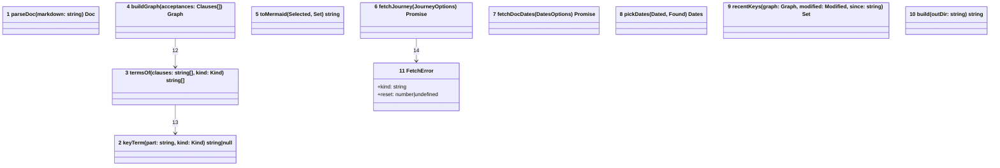

# Code

Numbers on classes and relationships match the callout table.

| #   | Description                                                                 | Why                                                  |
| --- | --------------------------------------------------------------------------- | ---------------------------------------------------- |
| 1   | [Reads one requirements doc](../../src/core.ts) into its acceptances.       | Each acceptance keeps its lines for blame.           |
| 2   | [Reduces a clause part](../../src/core.ts) to one key term.                 | Filler, numerals and quantifiers never make a term.  |
| 3   | [Splits clauses](../../src/core.ts) and keeps each part's term once.        | Compound clauses give one term per part.             |
| 4   | [Joins acceptances](../../src/core.ts) into term nodes and weighted edges.  | Edges run Given to When to Then.                     |
| 5   | [Writes the Mermaid text](../../src/core.ts) for the selected terms.        | The same input always gives the same text.           |
| 6   | [Fetches every repo's docs](../../src/core.ts) with a concurrency limit.    | One failed repo never breaks the rest.               |
| 7   | [Fetches one doc's blame and history](../../src/core.ts).                   | Dates load after the graph is drawn.                 |
| 8   | [Picks added and modified](../../src/core.ts) for one acceptance.           | Pure, so a test proves it without a network.         |
| 9   | [Finds terms that mostly changed](../../src/core.ts) in a window.           | A dot marks them, so the graph stays readable.       |
| 10  | [Writes the one-file page](../../src/build.ts).                             | The page opens from disk.                            |
| 11  | [A failed GitHub answer](../../src/core.ts): token, rate or HTTP.           | The page words each kind its own way.                |
| 12  | The graph reads each clause list through its terms.                         | Shared terms join one node.                          |
| 13  | Each clause part becomes at most one term.                                  | Parts made only of filler give none.                 |
| 14  | Bad tokens and rate limits stop the run; other errors stay per repo.        | One error card per failed repo.                      |
