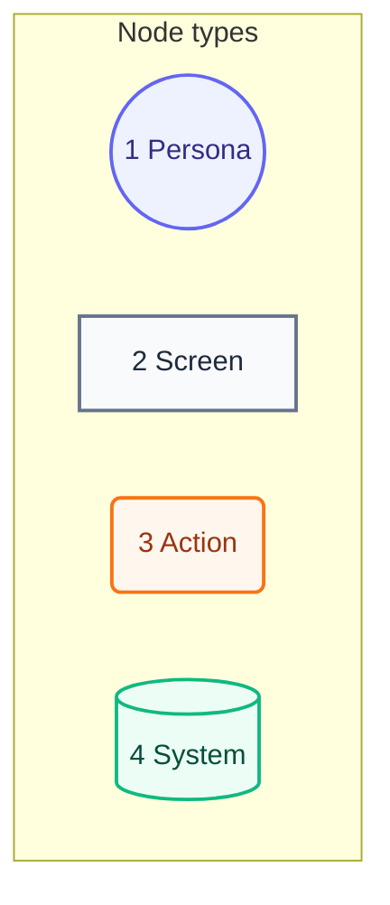

# User Journey

## Legend



Numbers match the callout table.

| #   | Description | Why                                   |
| --- | ----------- | ------------------------------------- |
| 1   | Persona     | A person the system context declares. |
| 2   | Screen      | What the person sees.                 |
| 3   | Action      | What the person does.                 |
| 4   | System      | What the product does in reply.       |

## Journey

```mermaid
flowchart TB
    viewer((1 Viewer)):::persona
    token[2 Paste-token screen<br/>Req 0001]:::screen
    fetch[(3 Read every repo's docs<br/>Req 0001)]:::system
    reduce[(4 Reduce clauses to key terms<br/>Req 0002)]:::system
    graph[5 Journey graph<br/>Req 0003]:::screen
    tap(6 Tap a term<br/>Req 0004):::action
    details[7 Acceptances with links<br/>Req 0004]:::screen

    viewer --> token
    token --> fetch
    fetch --> reduce
    reduce --> graph
    graph --> tap
    tap --> details
    graph -->|Refresh 0004| fetch

    classDef persona fill:#eef2ff,stroke:#6366f1,color:#312e81,stroke-width:2px
    classDef screen fill:#f8fafc,stroke:#64748b,color:#1e293b,stroke-width:2px
    classDef action fill:#fff7ed,stroke:#f97316,color:#9a3412,stroke-width:2px
    classDef system fill:#ecfdf5,stroke:#10b981,color:#064e3b,stroke-width:2px
```

Numbers match the callout table.

| #   | Description                                         | Type    | Why                                         |
| --- | --------------------------------------------------- | ------- | ------------------------------------------- |
| 1   | The viewer.                                         | Persona | Same person as the system context.          |
| 2   | With no token or a bad one, the page asks for one.  | Screen  | The token stays in that browser only.       |
| 3   | The page reads each repo's requirement docs.        | System  | A failed repo or rate limit shows a card.   |
| 4   | Each clause part shrinks to one key term.           | System  | Shared terms join one node.                 |
| 5   | Terms form one graph, Given to When to Then.        | Screen  | Sliders set the node cap and minimum count. |
| 6   | The viewer taps or presses Enter on a term.         | Action  | Keyboard and touch both work.               |
| 7   | Each acceptance shows its text, doc, Source, test.  | Screen  | It leads to the code behind the term.       |
